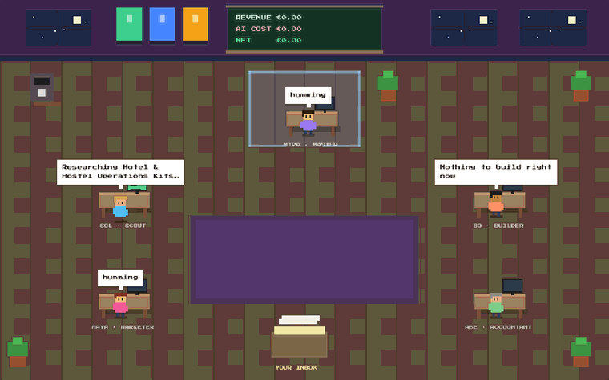
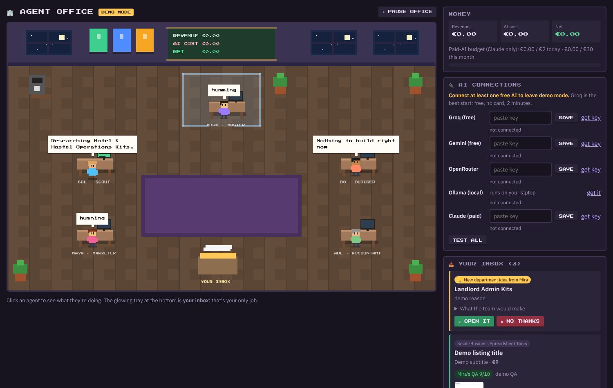
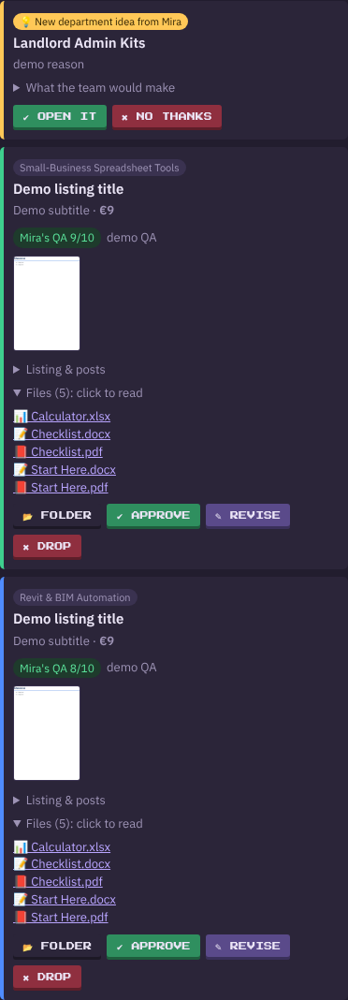
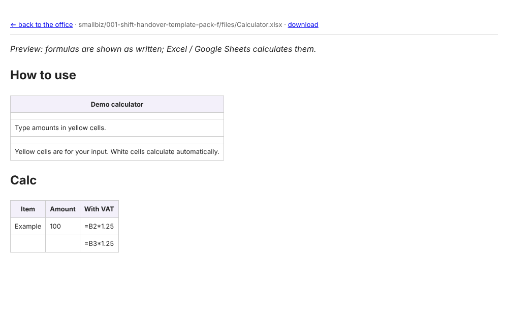
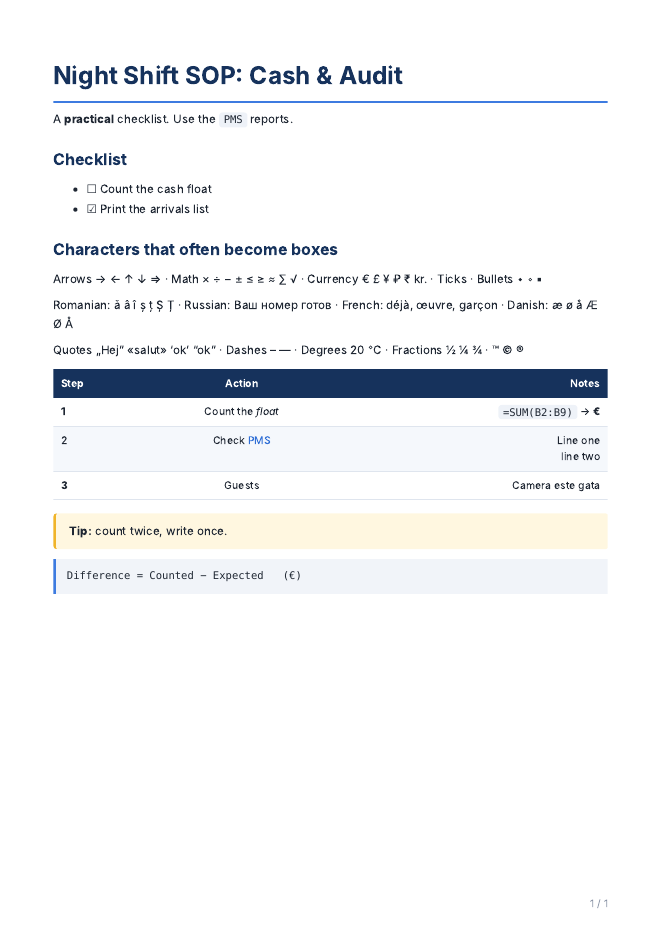
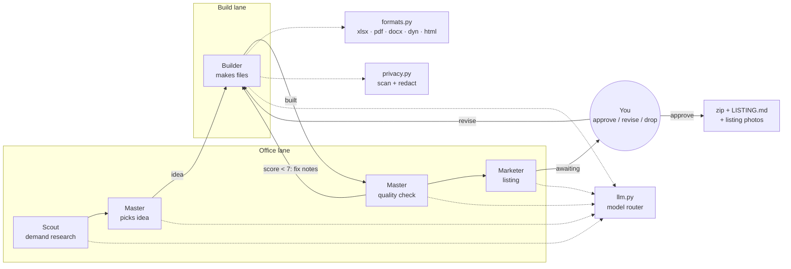
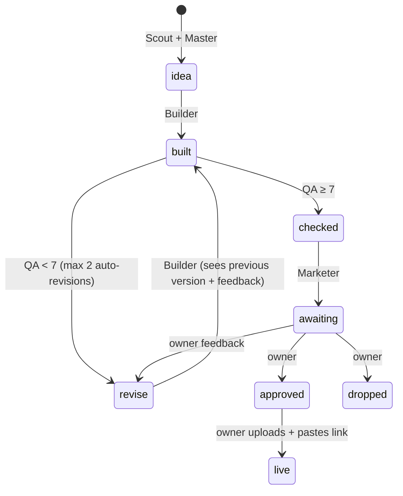

# 🏢 Agent Office [](LICENSE)

**A small team of AI agents that researches, builds, quality-checks and lists digital products, shown as a pixel-art office you can watch.**



Five agents run a tiny digital-products studio on your own computer. A **Scout** looks for proven demand, a **Master** picks ideas and quality-checks every product, a **Builder** makes the actual files (real Excel workbooks with formulas, Word + PDF documents, offline browser tools, Revit Dynamo graphs), a **Marketer** writes marketplace-ready listings and an **Accountant** tracks costs and limits. The human stays in the loop: nothing is published without your approval.

It runs on **free AI models by default** (Gemini, Groq, OpenRouter, or a local model via Ollama), switches automatically when one hits its limit, and can optionally use a paid model with hard budget caps.

> This is a personal engineering project, not a get-rich-quick tool. It makes no income claims; see [Limitations](#limitations--honest-results).

---

## Highlights

| | |
|---|---|
| 🤖 **Multi-agent pipeline** | Research → pick → build → QA → listing → human approval, with automatic revision loops |
| 🔀 **Model routing with fallback** | Per-agent model chains, retries on overload, cool-downs on rate limits, per-model (not per-provider) health |
| ⚡ **Two parallel work lanes** | The Builder works while the reviewer/researcher lane checks and lists other products |
| ✅ **Quality gate** | Rubric-based scoring by a *different* model than the builder, plus deterministic checks (formula sanity, Python syntax, missing requirements, offline-only browser tools, Dynamo safety) |
| 📦 **Finished products, not snippets** | `.xlsx` with working formulas, input cells and dropdowns; PDF + DOCX; Dynamo Player `.dyn` graphs; self-contained HTML tools; runnable Python projects |
| 🔒 **Privacy by design** | Personal data (e-mails, phone, CPR, IBAN, card, passport numbers) is scrubbed from every prompt and blocked from products; no buyer data stored; self-hosted fonts; sandboxed previews |
| 💶 **Cost control** | Daily/monthly caps for paid models, cost-per-product tracking, and a self-ending trial with a side-by-side quality comparison |
| 🎮 **Game-style dashboard** | Canvas-rendered pixel office (agents walk, talk, nap), inbox, connections, departments, money board |

## Screenshots

| Dashboard | Inbox with quality score and previews |
|---|---|
|  |  |

| Spreadsheet preview (real formulas) | PDF output (printed by the local browser engine) |
|---|---|
|  |  |

---

## Architecture



**Product lifecycle** (a small state machine stored in SQLite):



**Model router** (`agency/llm.py`): each agent has an ordered chain such as
`builder = [claude, gemini-flash, groq, gemini-flash-lite, openrouter-free, ollama-local]`.
A model is skipped if it has no key, is cooling down after a rate limit, is paid and over budget or outside its trial window. Overload errors (503, dropped connections) are retried with back-off before moving on. If nothing is available the agents "nap" and retry; the office never crashes.

### Key design decisions

- **Human-in-the-loop publishing.** Marketplaces ban bot-created listings, and a person should own what gets sold. The office prepares everything; the owner approves and uploads.
- **Builder writes structured text, the office produces the files.** The LLM emits Markdown and JSON specs (`=== SHEET ===`, `=== DYNAMO ===`, …); deterministic code turns them into `.xlsx`, `.dyn`, PDF and DOCX. That keeps formats valid and makes every file checkable.
- **Different model for QA than for building**, and a rubric (usable / complete / correct / specific / worth the price) instead of a single "rate 1–10". Self-grading inflated scores to 9/10 on everything.
- **Format follows the buyer.** Non-technical buyers get spreadsheets, documents or offline browser tools; Revit users get Dynamo Player graphs; Python projects only when the buyer *is* a coder. Code files are never shipped loose.
- **AI-written code is inspected, never executed** on the host. Browser-tool previews run in a CSP sandbox with no network or form access.
- **PDFs via the browser already on the machine** (Edge/Chrome headless) for typography and Unicode coverage, with a font fallback chain against "tofu" boxes and a pure-Python fallback engine.

## Quick start

Requirements: Python 3.10+.

```bash
# Windows: double-click START_OFFICE.bat
# macOS / Linux:
./start.sh
```

Open <http://localhost:8000>. With no AI connected it runs in **demo mode** (fake output, free) so you can watch the pipeline. Paste a free key (Gemini or Groq) into **AI connections** to go live. Optional: `INSTALL_LOCAL_AI.bat` installs Ollama with a model sized to your machine.

Everything is configured in [`config.toml`](config.toml): departments, model chains, budgets, privacy and rendering options.

## Project structure

```
run.py              FastAPI server: dashboard API, file viewer, sandboxed previews
agency/core.py      config, SQLite state, key storage
agency/llm.py       model router: chains, retries, cool-downs, budget + trial, prompt redaction
agency/agents.py    the agents' jobs and prompts (scout, pick, build, QA, listing, growth)
agency/runner.py    two work lanes (build / office), scheduling, recovery
agency/formats.py   xlsx / pdf / docx / dyn / html generation + deterministic checks
agency/privacy.py   personal-data scanner and redactor
agency/mock.py      demo-mode replies (no API key needed)
static/index.html   pixel office + dashboard (vanilla JS, canvas)
tests/              pytest suite
```

## Tests

```bash
pip install -r requirements-dev.txt
pytest -q
```

Covers the privacy scanner, JSON extraction from messy model output, model fallback / retry / budget / trial logic, spreadsheet generation and formula checks, Dynamo graph wiring, browser-tool and Python-project validation, and the full idea → inbox pipeline in demo mode. Runs in CI on every push.

## Limitations & honest results

- Product quality depends heavily on the model doing the building; small local models produce noticeably weaker products.
- Free tiers change and rate-limit often; the router handles it, but throughput varies.
- Demand research is only as good as its sources (Reddit by default; optional paid web search).
- As of writing, the project has produced sellable products, but **no meaningful sales**. Distribution, not production, turned out to be the hard part.

See [docs/case-study.md](docs/case-study.md) for the problems I ran into and how they were solved.

## How it was built

Designed, directed and tested by me; implemented iteratively with an AI coding assistant (Claude) as pair programmer. I can walk through every part of the system and the reasoning behind each decision.

## License

**[PolyForm Noncommercial 1.0.0](LICENSE)**: you're welcome to read, run, learn from and modify this project for
personal, educational and other non-commercial purposes. **Commercial use (including selling it or products made
with it as a service) requires my permission**; open an issue or contact me via GitHub.

Bundled fonts (Press Start 2P, IBM Plex Sans) are under the SIL Open Font License.
